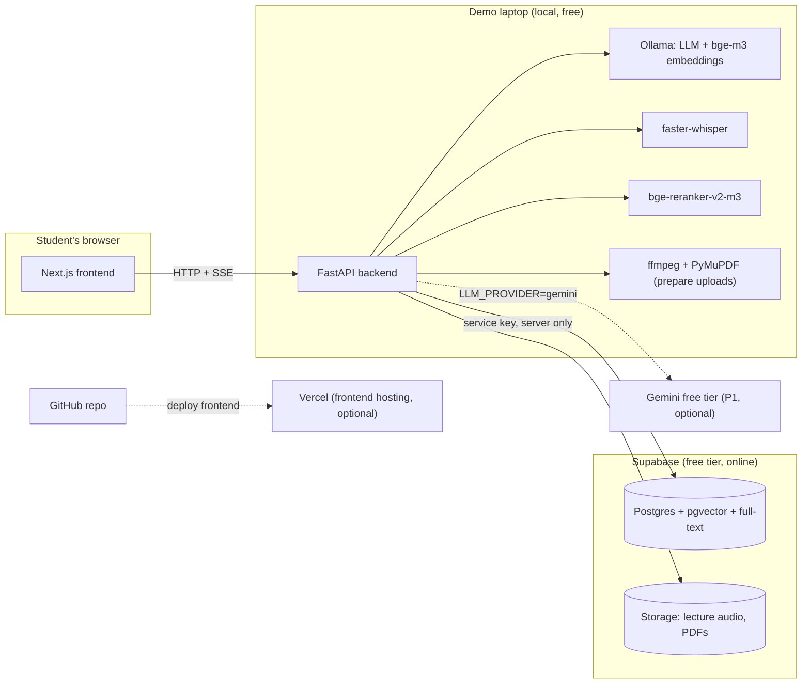
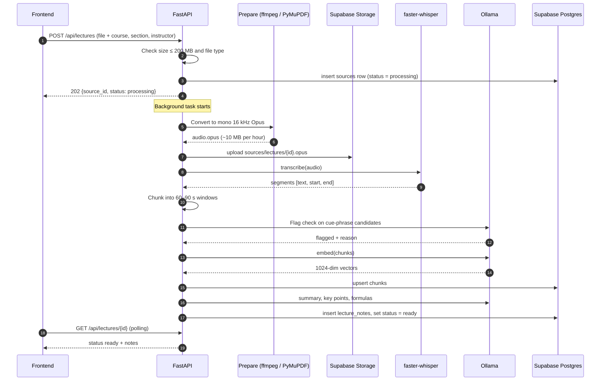
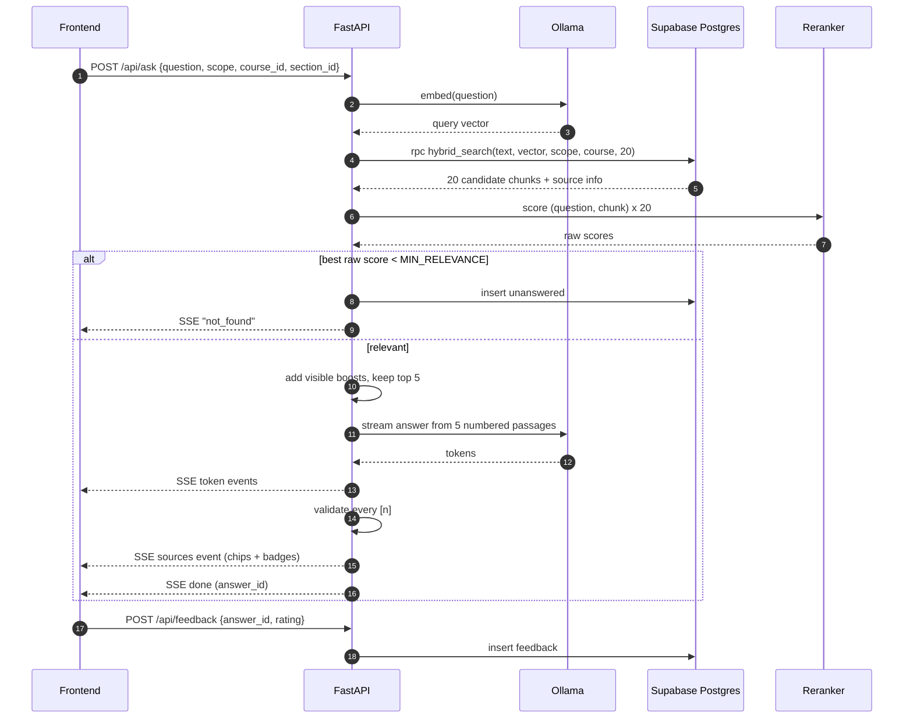
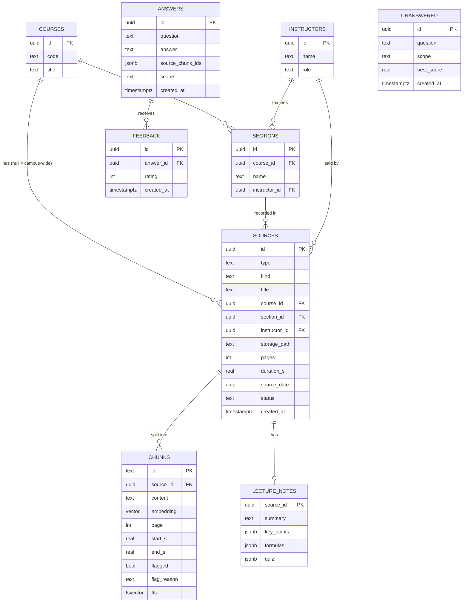

# CampusMind — Architecture

**Version:** v2 · **Last updated:** 2026-11-09 · Read with `PRD.md` and `Rules.md`.

---

## 1. System overview

CampusMind is a Retrieval-Augmented Generation (RAG) system with:

- **Online knowledge base:** Supabase (Postgres + pgvector + Storage), shared by everyone.
- **Local AI:** Ollama (LLM + embeddings), faster-whisper (speech-to-text), a cross-encoder reranker, all free and on the laptop.
- **Backend:** FastAPI (Python). It is the **only** thing that talks to Supabase and Ollama.
- **Frontend:** Next.js website with the liquid-glass minimal design.



## 2. Key decisions

| Decision | Choice | Reason |
| --- | --- | --- |
| Knowledge base | **Supabase Postgres + pgvector** | Free, online, shared; vectors + metadata + feedback in one place; SQL full-text gives keyword search |
| File storage | Supabase Storage (bucket `sources`) | Originals for playback and page view; 1 GB free |
| LLM | Ollama local (default); Gemini free tier as P1 switch | AED 0, private; Gemini enables multi-user later |
| Embeddings | `bge-m3` via Ollama, 1024 dimensions | Multilingual, strong retrieval |
| Retrieval | Hybrid: pgvector cosine + Postgres full-text, merged with RRF **in one SQL function** | Meaning + exact terms in a single round trip |
| Reranker | `BAAI/bge-reranker-v2-m3` (sentence-transformers) | Largest accuracy gain |
| Priority | Visible boosts after reranking (Official, IC/HOD, Flagged, Your section) | Instructor hierarchy without hidden ranking |
| Speech-to-text | faster-whisper `small`, int8 on CPU | Free, timestamps |
| Upload prep | ffmpeg → mono 16 kHz Opus 24 kbps; PyMuPDF compression for PDFs > 20 MB | Smaller storage, faster Whisper |
| Frameworks | No LangChain / LlamaIndex | Thin pipeline, easy to debug and explain |
| Offline fallback | Same schema on local Supabase (`supabase start`, needs Docker) | Demo survives bad Wi-Fi with a URL change |

**We do not train a model.** Knowledge lives in the database; the LLM only reads retrieved passages and writes the answer.

## 3. Flows

### 3.1 Upload and indexing



PDFs follow the same path without Whisper: PyMuPDF reads text per page → chunk by paragraph within a page → embed → upsert.

### 3.2 Answering a question



### 3.3 Priority boosts (after reranking)

```
final_score = rerank_score
            + BOOST_OFFICIAL   if source.kind in (campus, handout)
            + BOOST_SENIOR     if instructor.role in (ic, hod)
            + BOOST_FLAGGED    if chunk.flagged
            + BOOST_SECTION    if source.section_id == user's section_id
```

Defaults: 0.04 / 0.04 / 0.05 / 0.03. The relevance gate uses the **raw** `rerank_score`, never `final_score`. Every applied boost becomes a badge on the chip.

## 4. Data model (Supabase)



Field values: `sources.type` = `pdf` | `lecture` · `sources.kind` = `campus` | `handout` | `lecture` · `instructors.role` = `ic` | `hod` | `instructor` · `sources.status` = `processing` | `ready` | `failed` · `feedback.rating` = `1` | `-1`.

### 4.1 Schema migration (`supabase/migrations/0001_init.sql`)

```sql
create extension if not exists vector;

create table courses (
  id uuid primary key default gen_random_uuid(),
  code text unique not null,
  title text not null
);

create table instructors (
  id uuid primary key default gen_random_uuid(),
  name text not null,
  role text not null check (role in ('ic', 'hod', 'instructor'))
);

create table sections (
  id uuid primary key default gen_random_uuid(),
  course_id uuid not null references courses(id) on delete cascade,
  name text not null,
  instructor_id uuid references instructors(id),
  unique (course_id, name)
);

create table sources (
  id uuid primary key default gen_random_uuid(),
  type text not null check (type in ('pdf', 'lecture')),
  kind text not null check (kind in ('campus', 'handout', 'lecture')),
  title text not null,
  course_id uuid references courses(id),
  section_id uuid references sections(id),
  instructor_id uuid references instructors(id),
  storage_path text,
  pages int,
  duration_s real,
  source_date date,
  status text not null default 'processing' check (status in ('processing', 'ready', 'failed')),
  error text,
  created_at timestamptz not null default now()
);

create table chunks (
  id text primary key,                       -- deterministic: {source_id}_{page|start}_{n}
  source_id uuid not null references sources(id) on delete cascade,
  content text not null,
  embedding vector(1024) not null,
  page int,
  start_s real,
  end_s real,
  flagged boolean not null default false,
  flag_reason text,
  fts tsvector generated always as (to_tsvector('english', content)) stored
);
create index chunks_embedding_idx on chunks using hnsw (embedding vector_cosine_ops);
create index chunks_fts_idx on chunks using gin (fts);
create index chunks_source_idx on chunks (source_id);

create table lecture_notes (
  source_id uuid primary key references sources(id) on delete cascade,
  summary text,
  key_points jsonb default '[]',
  formulas jsonb default '[]',
  quiz jsonb
);

create table answers (
  id uuid primary key default gen_random_uuid(),
  question text not null,
  answer text not null,
  source_chunk_ids jsonb not null,
  scope text,
  created_at timestamptz not null default now()
);

create table feedback (
  id uuid primary key default gen_random_uuid(),
  answer_id uuid not null references answers(id) on delete cascade,
  rating int not null check (rating in (1, -1)),
  created_at timestamptz not null default now()
);

create table unanswered (
  id uuid primary key default gen_random_uuid(),
  question text not null,
  scope text,
  best_score real,
  created_at timestamptz not null default now()
);

-- Security: no login yet, so the browser never talks to Supabase.
-- RLS on with no policies = only the backend's service key can read/write.
alter table courses enable row level security;
alter table instructors enable row level security;
alter table sections enable row level security;
alter table sources enable row level security;
alter table chunks enable row level security;
alter table lecture_notes enable row level security;
alter table answers enable row level security;
alter table feedback enable row level security;
alter table unanswered enable row level security;
```

### 4.2 Hybrid search function (`0002_hybrid_search.sql`)

> **Current version: `0012_hybrid_search_hnsw.sql`.** Same signature and output. The semantic half orders by `embedding::halfvec(1024) <=> query` on the HNSW index `chunks_embedding_hv_idx` (0011) with `hnsw.iterative_scan = relaxed_order`, so status, course and source filters apply during the index walk; the full-text half ORs the query terms over the GIN index. Execute is granted to `service_role` only. The SQL below is the original design.

```sql
create or replace function hybrid_search(
  query_text text,
  query_embedding vector(1024),
  match_count int default 20,
  filter_type text default null,      -- 'pdf' | 'lecture' | null (all)
  filter_course uuid default null,    -- course chosen by the student; campus docs always included
  rrf_k int default 60
)
returns table (chunk_id text, rrf_score double precision)
language sql stable
as $$
  with candidates as (
    select c.*
    from chunks c
    join sources s on s.id = c.source_id
    where s.status = 'ready'
      and (filter_type is null or s.type = filter_type)
      and (filter_course is null or s.course_id is null or s.course_id = filter_course)
  ),
  full_text as (
    select id, row_number() over (
      order by ts_rank_cd(fts, websearch_to_tsquery('english', query_text)) desc
    ) as rank_ix
    from candidates
    where fts @@ websearch_to_tsquery('english', query_text)
    limit match_count * 2
  ),
  semantic as (
    select id, row_number() over (order by embedding <=> query_embedding) as rank_ix
    from candidates
    order by embedding <=> query_embedding
    limit match_count * 2
  )
  select
    coalesce(f.id, s.id) as chunk_id,
    coalesce(1.0 / (rrf_k + f.rank_ix), 0.0) + coalesce(1.0 / (rrf_k + s.rank_ix), 0.0) as rrf_score
  from full_text f
  full outer join semantic s on f.id = s.id
  order by rrf_score desc
  limit match_count;
$$;
```

The backend then fetches the chunk rows and their source/instructor/section info in one query by `chunk_id`.

## 5. Tech stack

| Layer | Technology | Notes |
| --- | --- | --- |
| Knowledge base | Supabase Postgres 15+ with `pgvector` | Free tier: 500 MB DB, 2 projects, pauses after 1 week idle |
| File storage | Supabase Storage, private bucket `sources` | Free tier: 1 GB |
| LLM runtime | Ollama on `localhost:11434` | |
| LLM | `gemma4:e4b` default · `gpt-oss:20b` on ≥ 16 GB VRAM · small model on 8 GB laptops | Verify tags with `ollama pull`; set `LLM_MODEL` |
| Embeddings | `bge-m3` via Ollama (1024-dim) | Changing it means re-embedding everything |
| Reranker | `BAAI/bge-reranker-v2-m3` | CPU is fine for 20 pairs |
| Speech-to-text | `faster-whisper` `small`, int8 | `medium` with a GPU |
| Upload prep | `ffmpeg` (system binary), PyMuPDF | |
| Backend | Python 3.11, FastAPI, Uvicorn, `sse-starlette`, `supabase` client, `httpx` | |
| Frontend | Next.js (App Router), TypeScript, Tailwind, lucide-react | Design in `design.md` |
| P1 LLM | Gemini Flash free tier via `google-genai` | Only when `LLM_PROVIDER=gemini` |
| Code | GitHub private repo | `main` always runnable |
| Hosting | Demo on laptop; frontend optionally on Vercel | Backend stays local in Round 1 |

## 6. Project directory structure

```
campusmind/
├── README.md                     # run it in ≤ 6 commands
├── CLAUDE.md                     # = docs/handoff.md
├── docs/
│   ├── PRD.md  Architecture.md  Rules.md  memory.md  design.md  tasks.md  handoff.md
├── supabase/
│   ├── migrations/
│   │   ├── 0001_init.sql
│   │   └── 0002_hybrid_search.sql
│   └── seed.sql                  # demo courses, sections, instructors
├── backend/
│   ├── .env.example
│   ├── requirements.txt
│   ├── app/
│   │   ├── main.py               # FastAPI app, CORS, routers, startup model loading
│   │   ├── config.py             # pydantic-settings
│   │   ├── schemas.py            # request/response models
│   │   ├── db.py                 # Supabase client (service key) + queries
│   │   ├── api/
│   │   │   ├── health.py         # GET  /api/health
│   │   │   ├── catalog.py        # GET  /api/courses (with sections, instructors)
│   │   │   ├── ask.py            # POST /api/ask (SSE)
│   │   │   ├── feedback.py       # POST /api/feedback
│   │   │   ├── documents.py      # POST/GET/DELETE /api/documents
│   │   │   ├── lectures.py       # POST/GET /api/lectures, GET /api/lectures/{id}
│   │   │   ├── flagged.py        # GET  /api/flagged?course_id=
│   │   │   └── insights.py       # GET  /api/insights (unanswered, thumbs-down)
│   │   ├── ingest/
│   │   │   ├── prepare.py        # ffmpeg audio prep, PDF compression, size checks
│   │   │   ├── pdf_loader.py     # PDF → [{text, page}]
│   │   │   ├── transcriber.py    # audio → [{text, start, end}]
│   │   │   ├── chunker.py        # page / time-window chunks with deterministic ids
│   │   │   ├── flagger.py        # cue phrases + LLM confirmation
│   │   │   ├── lecture_notes.py  # summary, key points, formulas (+ quiz in P1)
│   │   │   └── pipeline.py       # orchestrates a full upload as a background task
│   │   ├── rag/
│   │   │   ├── embedder.py       # Ollama /api/embed, batched
│   │   │   ├── retriever.py      # rpc hybrid_search + fetch chunk details
│   │   │   ├── reranker.py
│   │   │   ├── priority.py       # visible boosts + badge list
│   │   │   ├── prompts.py        # ALL prompts
│   │   │   └── answerer.py       # gate → LLM stream → citation check → save answer
│   │   └── llm/
│   │       ├── base.py           # LLMProvider: generate(), stream()
│   │       ├── ollama_provider.py
│   │       └── gemini_provider.py   # P1
│   ├── eval/
│   │   ├── questions.json        # 15 Q + expected source, 3 out-of-scope
│   │   └── run_eval.py
│   ├── tmp/                      # git-ignored scratch for uploads in progress
│   └── tests/
└── frontend/
    ├── .env.local.example        # NEXT_PUBLIC_API_URL=http://localhost:8000
    ├── app/
    │   ├── layout.tsx
    │   ├── page.tsx              # Ask
    │   ├── lectures/page.tsx
    │   ├── lectures/[id]/page.tsx   # Summary · Flagged · Transcript · Ask this lecture
    │   ├── flagged/page.tsx      # Flagged in my course
    │   ├── sources/page.tsx      # documents
    │   └── insights/page.tsx     # unanswered + thumbs-down
    ├── components/
    │   ├── GlassNav.tsx  CourseSelector.tsx  ScopeToggle.tsx  AskBox.tsx
    │   ├── AnswerView.tsx  SourceChip.tsx  Badge.tsx  SourcePanel.tsx
    │   ├── FeedbackButtons.tsx  UploadCard.tsx  Transcript.tsx  FlaggedList.tsx
    ├── lib/
    │   ├── api.ts                # all fetch + SSE calls
    │   └── prefs.ts              # remembered course/section (localStorage, try/catch)
    └── styles/globals.css        # design tokens
```

## 7. API contract

| Method | Path | Request | Response |
| --- | --- | --- | --- |
| GET | `/api/health` | — | `{ollama, supabase, llm_model, chunks}` |
| GET | `/api/courses` | — | `[{id, code, title, sections: [{id, name, instructor: {name, role}}]}]` |
| POST | `/api/ask` | `{question, scope: all\|docs\|lectures, course_id?, section_id?, lecture_id?}` | SSE: `token` · `sources` `[{n, title, kind, page?, start_s?, source_id, excerpt, badges[]}]` · `not_found` · `done {answer_id}` · `error` |
| POST | `/api/feedback` | `{answer_id, rating: 1\|-1}` | `{ok}` |
| POST | `/api/documents` | multipart `file`, `title`, `kind`, `course_id?`, `source_date?` | `202 {source_id, status}` |
| GET | `/api/documents` | — | list |
| DELETE | `/api/documents/{id}` | — | `{ok}` |
| POST | `/api/lectures` | multipart `file`, `title`, `course_id`, `section_id`, `instructor_id`, `source_date` | `202 {source_id, status}` |
| GET | `/api/lectures` | `?course_id=` | list with status |
| GET | `/api/lectures/{id}` | — | `{status, transcript[], summary, key_points[], formulas[], flagged[], audio_url}` |
| GET | `/api/flagged` | `?course_id=` | `[{source_id, title, start_s, reason, instructor}]` |
| GET | `/api/insights` | — | `{unanswered: [{question, count, last_at}], thumbs_down: [...]}` |

`audio_url` is a short-lived signed URL from Supabase Storage.

## 8. How everything connects

| From → to | How | Secrets |
| --- | --- | --- |
| Frontend → backend | `fetch` + SSE to `NEXT_PUBLIC_API_URL` | none |
| Backend → Supabase DB | `supabase` Python client, `rpc('hybrid_search')`, table queries | `SUPABASE_URL`, `SUPABASE_SERVICE_ROLE_KEY` (backend `.env` only) |
| Backend → Supabase Storage | `storage.from_('sources')` upload + signed URLs | same |
| Backend → Ollama | HTTP `OLLAMA_URL` `/api/chat`, `/api/embed` | none |
| Backend → Gemini (P1) | `google-genai`, only if `LLM_PROVIDER=gemini` | `GEMINI_API_KEY` |
| Schema → Supabase | SQL files in `supabase/migrations/`, applied with Supabase CLI or the Supabase MCP in Claude Code | — |
| Code → GitHub | private repo; branch per task; `main` always runs | never commit `.env` |
| GitHub → Vercel (optional) | import repo, root `frontend/`, set `NEXT_PUBLIC_API_URL` | — |

## 9. Configuration (`backend/.env.example`)

```
# Supabase (backend only — never in the frontend)
SUPABASE_URL=
SUPABASE_SERVICE_ROLE_KEY=
SUPABASE_BUCKET=sources

# Models
LLM_PROVIDER=ollama          # ollama | gemini
LLM_MODEL=gemma4:e4b
OLLAMA_URL=http://127.0.0.1:11434   # not localhost (Windows IPv6 delay)
EMBED_MODEL=bge-m3
EMBED_DIM=1024
RERANKER_MODEL=BAAI/bge-reranker-v2-m3
WHISPER_MODEL=small
GEMINI_API_KEY=
GEMINI_MODEL=gemini-flash-latest

# Retrieval
TOP_K_RETRIEVE=40
TOP_K_FINAL=5
MIN_RELEVANCE=0.02             # tuned in 2.9; see memory.md
BOOST_OFFICIAL=0.04
BOOST_SENIOR=0.04
BOOST_FLAGGED=0.05
BOOST_SECTION=0.03

# Uploads
MAX_UPLOAD_MB=200
PDF_COMPRESS_OVER_MB=20
AUDIO_BITRATE=24k
```

## 10. Upload preparation details

| Input | Command / call | Output |
| --- | --- | --- |
| mp4, mp3, m4a, wav | `ffmpeg -i in -vn -ac 1 -ar 16000 -c:a libopus -b:a 24k out.opus` | ~10 MB per hour; Whisper reads it directly |
| PDF > 20 MB | PyMuPDF `doc.save(out, garbage=4, deflate=True)` | Typically 20–50% smaller |
| PDF ≤ 20 MB | stored as-is | |
| Anything > 200 MB | rejected with a clear message | |

## 11. Hardware guide

| Laptop | `LLM_MODEL` | Expect |
| --- | --- | --- |
| 8 GB RAM, no GPU | a ~2–4B model (e.g. `gemma4:e2b`) | Slow; pre-process all demo files |
| 16 GB RAM or 8 GB GPU | `gemma4:e4b` | Good for demo |
| 16 GB+ GPU or Apple M-series 32 GB | `gpt-oss:20b` | Best answers |
