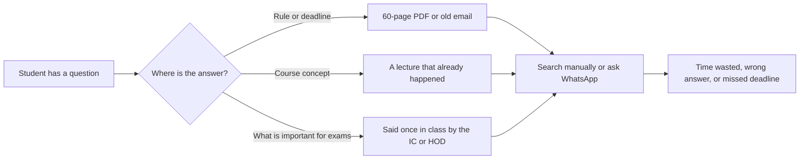
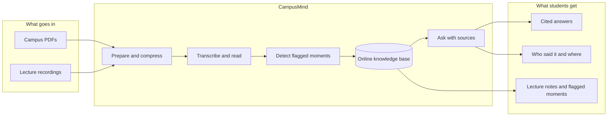
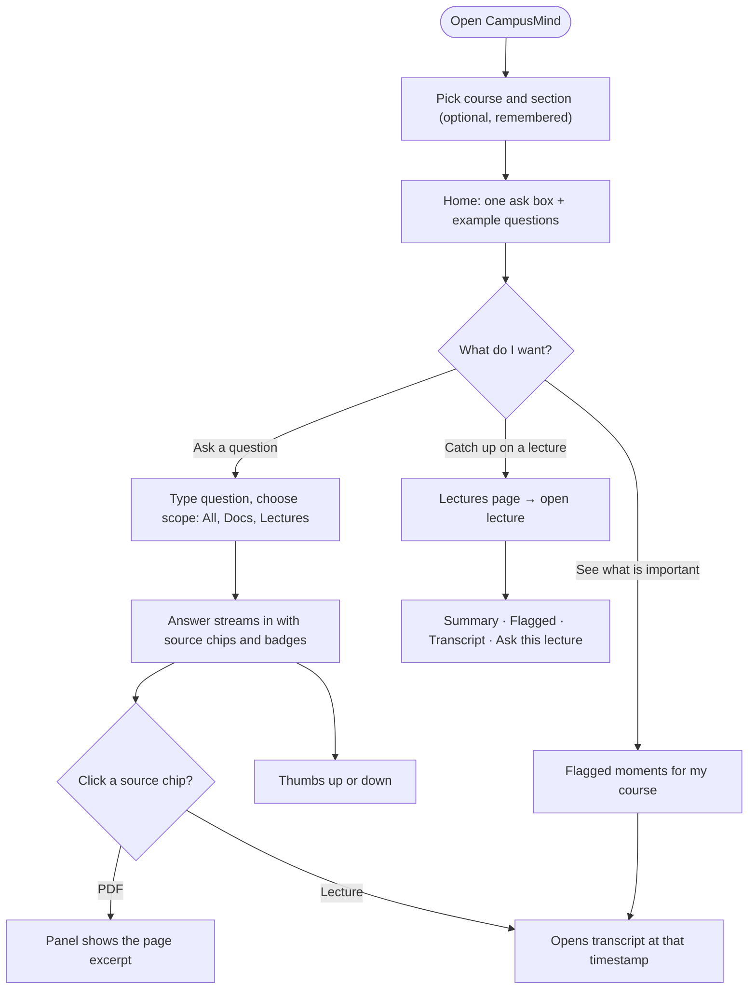
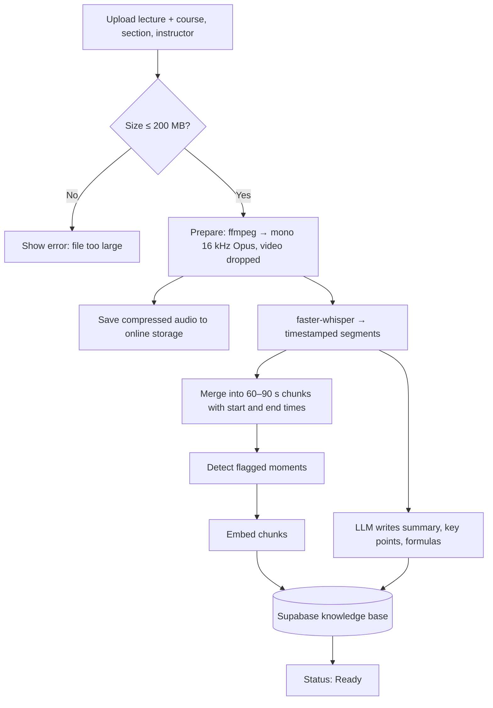
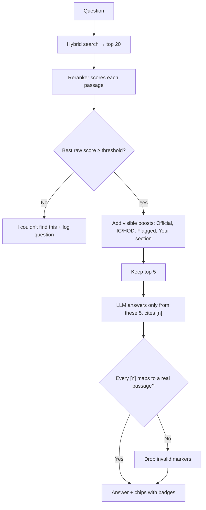
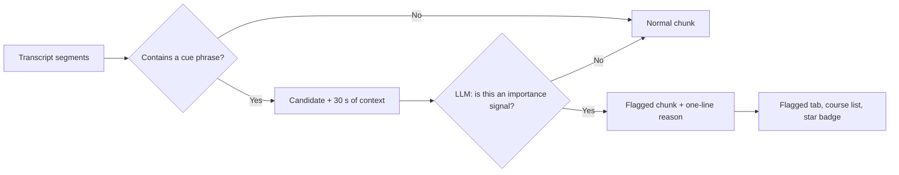
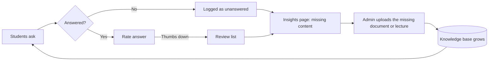

# CampusMind — Product Requirements Document (PRD)

| | |
| --- | --- |
| **Event** | IDEAVERSE 2026 (GDGoC BPDC × GDG HWUD × IEI) |
| **Theme** | Smart Campus, AI Solutions |
| **Owner** | Rishab Gupta, BITS Pilani Dubai Campus |
| **Version** | v2 — online knowledge base, instructor priority, flagged moments, feedback loop |
| **Last updated** | 2026-11-09 |
| **Deadlines** | Round 1: 10 Nov 2026 · Final pitch: 11 Nov 2026 |

> Diagrams use Mermaid. They render on GitHub, in VS Code (Markdown Preview Mermaid Support extension) and at mermaid.live.

---

## 1. One-line pitch

**CampusMind is a free AI assistant that knows your campus rules and your course lectures, tells you what your instructors flagged as important, and proves every answer with its source.**

## 2. The problem

**Problem statement:** *Students cannot quickly get trustworthy answers from their own campus documents and lectures, and they miss what their instructors said was important.*

| Where information lives | What goes wrong today |
| --- | --- |
| Academic regulations, handbooks, circulars (PDFs) | Long and dense; keyword search fails ("makeup test" vs "missed exam") |
| Email notices | Buried; deadlines get missed |
| Lectures (spoken once) | Gone after class; cannot search what the professor said |
| "This will come in the exam" moments | Heard only by students who were present and paying attention |
| Different sections, different instructors | Students hear different explanations; no single place to compare |
| WhatsApp groups and seniors | Fast but often wrong or outdated |

**Who is hurt most:** students who missed a class, non-native English speakers, students with hearing difficulties, first-years who don't know where rules are written.

## 3. The solution

CampusMind turns campus PDFs and lecture recordings into **one shared online knowledge base**. Students ask in plain language and get a short answer with **source chips** (document page or lecture timestamp), **who said it** (IC, HOD, section instructor) and **whether the instructor flagged it as important**.

## 4. How AI solves it

| AI component | Job | Why it is needed |
| --- | --- | --- |
| Speech-to-text (faster-whisper) | Lecture audio → timestamped transcript | Makes spoken content searchable |
| Embedding model (bge-m3) | Text → meaning vectors | Finds passages by meaning, not exact words; works for Arabic and Hindi too |
| Hybrid search (vectors + Postgres full-text) | Finds candidates by meaning **and** exact terms | Catches "Rule 4.3", course codes, formulas |
| Reranker (bge-reranker-v2-m3) | Picks the best 5 of 20 | Biggest accuracy gain for small RAG systems |
| LLM (open-source via Ollama) | Writes the answer **only** from those passages, with citations | Natural answers without invented rules |
| LLM + phrase detection | Finds "this will come in the exam" moments | Surfaces what instructors said was important |

**What AI does not do here:** it does not train or learn on its own from usage. The system improves through the **feedback loop** (Section 7.7): more uploads, rated answers, and a list of unanswered questions that tells admins exactly what to add.

## 5. Users and user stories

| # | As a… | I want to… | So that… |
| --- | --- | --- | --- |
| U1 | Student | ask a rule question in plain words | I get the right rule in seconds with the page to prove it |
| U2 | Student who missed class | read a summary and ask about that lecture | I catch up without asking ten people |
| U3 | Student | pick my course and section | answers prefer my own instructor's explanation |
| U4 | Student revising | see everything instructors flagged as important | I focus on what matters for exams |
| U5 | Student | see who said something (IC, HOD, instructor) | I know how much weight to give it |
| U6 | Student | rate an answer | wrong answers get noticed and fixed |
| U7 | Admin / class rep | see questions CampusMind couldn't answer | I know which documents to upload next |
| U8 | Instructor / class rep | upload a lecture once | the whole batch can search it |

## 6. User journey

## 7. Features

Priority: **P0** = must work for Round 1 (10 Nov) · **P1** = add if Round 1 passes, before the Final (11 Nov) · **P2** = future scope, pitch only.

### 7.1 F1 — Ask CampusMind (P0)

- One ask box. Answer streams in plain language, ≤ 150 words.
- Every claim has an inline marker `[1]` linked to a **source chip**: `Academic Regulations · p. 12` or `MATH F113 · Lecture 4 · 12:40`.
- Scope toggle: **All · Campus docs · Lectures**.
- Clicking a chip opens the excerpt (PDF) or jumps to the transcript line (lecture).
- If nothing relevant is found → *"I couldn't find this in the campus sources."* and the question is logged (F7).

**Acceptance:** 13 of 15 test questions answered correctly with the right source; 3 of 3 out-of-scope questions refused; first words in under 5 s on the demo laptop.

### 7.2 F2 — Lecture mode (P0)

- Upload audio or video (mp3, m4a, wav, mp4; ≤ 200 MB) with: title, course, section, instructor, date.
- Output: timestamped transcript, 5-line summary, key points, formulas.
- Lecture is added to the knowledge base automatically.

**Acceptance:** a 5-minute lecture is Ready in under 3 minutes; a 1-hour lecture stores as about 10 MB of audio.

### 7.3 F3 — Campus documents (P0)

- Upload PDFs (regulations, handbook, circulars, course handouts) with: title, type (`campus` or `course handout`), course (optional), date.
- Indexed with page numbers. PDFs over 20 MB are compressed first.
- Re-uploading the same document replaces the old version.

### 7.4 F4 — Course, section and instructor (P0)

- Selector on the Ask page: **Course → Section**. The choice is remembered on the device.
- Each lecture is tagged with an instructor and their **role**: `IC` (Instructor-in-Charge), `HOD`, or `Instructor`.
- Answers search all sections of the course but **prefer** the student's own section and senior roles (F5).

### 7.5 F5 — Visible source priority (P0)

No secret ranking. When two passages are equally relevant, CampusMind prefers official and senior sources, and **always shows why** with a badge on the chip.

| Priority signal | Badge on chip | Effect |
| --- | --- | --- |
| Official course handout or campus regulation | `Official` | Small boost |
| Said by the IC or HOD | `IC` / `HOD` | Small boost |
| Flagged as important by the instructor | Star icon + `Flagged` | Small boost |
| From the student's own section | `Your section` | Small boost |
| Other sections | Instructor name only | No boost |

Rules: boosts only re-order passages that are already relevant. They never let an irrelevant passage through the "I couldn't find this" check, and they never hide a source. Boost sizes live in config.

### 7.6 F6 — Flagged by instructor (P0, the standout feature)

CampusMind finds the moments where an instructor signals importance: *"this will come in the exam"*, *"note this down"*, *"very important"*, *"remember this formula"*, *"this was asked last year"*.

- **Step 1 — phrase match:** a fixed list of cue phrases marks candidate transcript segments (fast, free).
- **Step 2 — LLM check:** the LLM reads each candidate with 30 s of context and confirms it, writing a one-line reason ("Exam hint: Bayes' theorem with two events").
- Shown as: a **Flagged** tab on each lecture, a "Flagged in this course" list, and a star badge on any chip from a flagged passage.

**Acceptance:** in the demo lecture, every planted "this will come in the exam" moment is flagged, with no more than 1 false flag.

### 7.7 F7 — Feedback loop: "gets smarter with use" (P0 lite, P1 full)

| Signal | Captured | Used for |
| --- | --- | --- |
| Thumbs up / down on an answer | question, answer, sources, rating | Find bad answers; add to the eval set |
| Unanswered question | question, scope, best score | "Missing content" list for admins |
| Most-asked questions | question text, count | Example questions on the home page (P1) |

### 7.8 F8 — Shared online knowledge base (P0)

- Knowledge base (vectors, text, metadata, feedback) is stored in **Supabase** (free tier: 500 MB database, 1 GB files).
- Anyone running the app reads the same knowledge base; one upload helps the whole batch.
- Answers are written by a local Ollama model in Round 1; online multi-user answering is P1 (F11).

### 7.9 P1 features (Final pitch, only if P0 is solid)

| # | Feature | Value |
| --- | --- | --- |
| F9 | Practice quiz: 5 MCQs per lecture, weighted toward flagged moments | Revision |
| F10 | Voice question (mic → Whisper → ask) | Accessibility, demo moment |
| F11 | Gemini free-tier answers + hosted backend, so anyone can use it from a phone | Real multi-user |
| F12 | Reply in the question's language (Arabic, Hindi) | Multilingual campus |
| F13 | Most-asked questions on the home page | Feedback loop visible |

### 7.10 P2 — future scope (pitch only)

- Login with BITS email; roles for students, class reps, faculty.
- Faculty upload directly; auto-sync of circulars.
- Same system for Heriot-Watt Dubai and any university.
- On-campus server so answers never leave the university.

## 8. Out of scope

- Training or fine-tuning models.
- Live lecture transcription.
- Native mobile app (the website is responsive).
- Scraping the BITS portal, LMS or email.
- Login and accounts (P2).
- Photos and scanned handwritten notes (needs OCR; P2).

## 9. Non-functional requirements

| Area | Requirement |
| --- | --- |
| Cost | AED 0. Free tiers and local models only |
| Privacy | Lectures uploaded only with the instructor's consent; Supabase keys stay on the backend; no tracking |
| Accuracy | Answers only from retrieved passages; every citation real; refuse below threshold |
| Speed | First words < 5 s; 5-minute lecture Ready < 3 min |
| Uploads | ≤ 200 MB per file; audio/video always converted to mono 16 kHz Opus; PDFs > 20 MB compressed |
| Accessibility | Keyboard navigation, AA contrast, transcripts for every lecture |
| Reliability | Demo works on phone hotspot; backup screen recording |

## 10. Success metrics

| Metric | Target for demo |
| --- | --- |
| Correct answers with the right source | ≥ 13 / 15 |
| Out-of-scope questions refused | 3 / 3 |
| Flagged-moment detection in demo lecture | all planted moments, ≤ 1 false flag |
| First-token time | < 5 s |
| 5-minute lecture processing | < 3 min |
| Running cost | AED 0 |

## 11. Demo script (about 2 minutes 30 seconds)

| Time | Step | What judges see |
| --- | --- | --- |
| 0:00 | Hook | "It's 11 pm, you missed the midsem. What's the makeup rule? Here's the 60-page PDF…" |
| 0:15 | Pick course | MATH F113, Section L2 |
| 0:25 | Lecture mode | Pre-processed lecture: summary, formulas, **Flagged** tab with "this will come in the exam" |
| 0:55 | Ask about the lecture | "What did the IC say about Bayes' theorem?" → answer + `Lecture 4 · IC · 12:40` + star |
| 1:20 | Ask a rule | "If I miss the midsem, what do I do?" → answer + `Academic Regulations · p. X · Official` |
| 1:40 | Trust | Ask something not in the sources → "I couldn't find this" |
| 1:55 | Feedback loop | Insights page shows that question as missing content |
| 2:10 | Close | Free, open-source, shared online, works for any university |

## 12. Risks and mitigations

| Risk | Mitigation |
| --- | --- |
| Wrong answer | Grounded prompt, reranker, relevance gate, citation check, eval set |
| Campus Wi-Fi fails during demo | Phone hotspot; Supabase can also run locally (`supabase start`) with the same schema; backup screen recording |
| Supabase free project paused (after 1 week idle) | Open the dashboard before each round |
| Slow local model | Pre-process all demo files; smaller model; Gemini switch (P1) |
| Instructor priority seen as unfair | All boosts visible as badges; never hides a source; boost sizes in config |
| False "flagged" moments | Two-step detection (phrase + LLM check); reason shown on hover |
| Lecture privacy | Upload only with consent; service keys server-side only |
