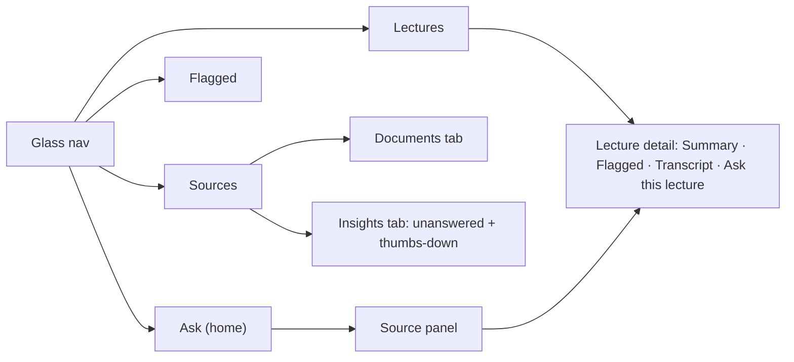

# CampusMind — Design Guide

**Version:** v2 · **Last updated:** 2026-11-09

**Goal:** a calm, minimal website that feels like a well-made Apple app, not an AI-generated template. A first-time user knows what to do within three seconds: **type a question**.

**Design reference skill:** https://github.com/dickwu/apple-design-skill.git
Install it for Claude Code before any UI work:

```bash
git clone https://github.com/dickwu/apple-design-skill.git .claude/skills/apple-design
```

Read its `SKILL.md` files (HIG, Liquid Glass, accessibility) and apply them **translated to web CSS**: Apple's Liquid Glass is a native SwiftUI material, so on the web we reproduce it with `backdrop-filter` (Section 5). Where the skill and this file disagree, this file wins on colours and "no gradients".

---

## 1. Principles

1. **One job per screen.** Ask = ask. Lectures = upload and read. Flagged = what's important. Sources = manage documents and see gaps.
2. **Content first, chrome second.** Glass only on navigation and controls; answers, transcripts and lists sit on solid surfaces.
3. **Plain colours, one accent.** No gradients anywhere.
4. **Quiet until needed.** Excerpts, transcripts, settings stay collapsed until asked for.
5. **Trust is visible.** Source chips and their badges (Official, IC, HOD, Flagged, Your section) are the most important UI after the answer itself.

## 2. What "vibecoded" looks like (never do this)

| Don't | Do instead |
| --- | --- |
| Purple-blue gradients, gradient text or buttons | Solid accent, solid text |
| Glowing shadows, neon borders | One soft shadow on floating glass only |
| "AI-powered" sparkle icons, robot icons, emoji in UI | Plain words; lucide line icons |
| Hero with three feature cards | The ask box *is* the home page |
| Everything `rounded-3xl` with border + shadow | Radii 10 / 14 / 20 px, borders 1 px |
| Many bold headings | One title per page |
| Dark background with colour blobs | Plain off-white or near-black |
| Typing effects, confetti, bouncy motion | 150–250 ms fades and short slides |
| "Lorem ipsum", "John Doe" | Real BPDC examples |
| A different colour for every badge | Neutral badges; accent only for "Your section"; amber only for "Flagged" |

## 3. Colour tokens (plain, no gradients)

CSS variables in `styles/globals.css`, mapped into Tailwind. Use only these.

| Token | Light | Dark | Use |
| --- | --- | --- | --- |
| `--bg` | `#F5F5F7` | `#000000` | Page background |
| `--surface` | `#FFFFFF` | `#1C1C1E` | Answer, transcript, lists |
| `--surface-2` | `#F2F2F7` | `#2C2C2E` | Inputs, chips, hover rows |
| `--text` | `#1D1D1F` | `#F5F5F7` | Main text |
| `--text-2` | `#6E6E73` | `#A1A1A6` | Secondary text, timestamps |
| `--border` | `#E5E5EA` | `#38383A` | 1 px hairlines |
| `--accent` | `#0A66FF` | `#409CFF` | Primary button, links, focus ring, "Your section" |
| `--accent-soft` | `#0A66FF14` | `#409CFF26` | Selected states (flat tint) |
| `--flag` | `#B25000` | `#FFB340` | Flagged star icon and label text only |
| `--flag-soft` | `#FF950014` | `#FF9F0A26` | Flagged badge background, transcript highlight |
| `--good` | `#248A3D` | `#30D158` | Thumbs-up selected only |
| `--danger` | `#D70015` | `#FF6961` | Errors, thumbs-down selected |
| `--glass` | `rgba(255,255,255,0.62)` | `rgba(28,28,30,0.55)` | Glass bars |
| `--glass-border` | `rgba(255,255,255,0.7)` | `rgba(255,255,255,0.12)` | Glass edge |

Check WCAG AA (4.5:1) for all text on its surface in both themes.

## 4. Typography

- System stack: `-apple-system, BlinkMacSystemFont, "SF Pro Text", "Inter", "Segoe UI", sans-serif`; load **Inter** via `next/font` as the cross-platform fallback.
- Sizes: **28** page title (600) · **17** body · **15** secondary · **13** chips, badges, timestamps.
- Line height 1.5 body, 1.2 titles. Max text width 680 px.
- Weights 400 and 600 only. Timestamps and page numbers use `tabular-nums`.

## 5. Liquid glass on the web

**Where (only these):** sticky top nav · floating ask bar at the bottom of the Ask page after the first answer · source panel / bottom sheet · course selector popover.

**Never:** on answer text, transcripts, list rows, tables, long dialogs.

```css
.glass {
  background: var(--glass);
  backdrop-filter: blur(24px) saturate(180%);
  -webkit-backdrop-filter: blur(24px) saturate(180%);
  border: 1px solid var(--glass-border);
  box-shadow:
    inset 0 1px 0 rgba(255, 255, 255, 0.5),  /* flat top highlight */
    0 8px 24px rgba(0, 0, 0, 0.08);          /* one soft lift */
  border-radius: 20px;
}
@supports not (backdrop-filter: blur(1px)) {
  .glass { background: var(--surface); }
}
@media (prefers-reduced-transparency: reduce) {
  .glass { background: var(--surface); backdrop-filter: none; }
}
```

Glass reads as glass only when content scrolls under it. Never add colour blobs behind it.

## 6. Layout and spacing

- Spacing scale: 4, 8, 12, 16, 24, 32, 48 px only.
- Page padding 16 px mobile, 32 px desktop. Content column max 760 px, centred.
- Radii: 10 (chips, badges, small buttons) · 14 (inputs, cards) · 20 (glass bars, panels).
- Responsive to 360 px wide. Touch targets ≥ 44 px.

## 7. Navigation and screens

Nav (glass, sticky): wordmark **CampusMind** (text only) · **Ask · Lectures · Flagged · Sources** · course selector on the right (`MATH F113 · L2`).



### 7.1 Ask (home)
- Empty state: title *"Ask anything about your courses or campus rules."* · ask box · 3 example questions as plain chips · scope segmented control **All · Campus docs · Lectures**.
- Question: right-aligned, `--surface-2` bubble. Answer: left, on `--surface`, no bubble border. `[1]` markers = small accent superscripts.
- Under the answer: source chips, then **feedback**: two icon buttons (`ThumbsUp`, `ThumbsDown`, 16 px, `--text-2`); selected state fills with `--good` / `--danger`; after a click show "Thanks" in `--text-2` for 2 s.
- "Couldn't find" state: `--text-2` text, no chips, a "Rephrase" hint.
- Loading: three-dot pulse in `--text-2`.

### 7.2 Source chip and badges

```
[ FileText  Academic Regulations · p. 12   Official ]
[ AudioLines  Lecture 4 · 12:40   IC   ★ Flagged   Your section ]
```

| Badge | Style |
| --- | --- |
| `Official` | `--surface` background, 1 px `--border`, `--text-2` |
| `IC` / `HOD` | same neutral style; tooltip "Instructor-in-Charge" / "Head of Department" |
| `Flagged` | `--flag-soft` background, `--flag` text, lucide `Star` 12 px (icon, never an emoji) |
| `Your section` | `--accent-soft` background, `--accent` text |

Max three badges per chip; order: Flagged, IC/HOD, Official, Your section. Tooltip on hover explains each.

### 7.3 Source panel
Desktop: glass side panel (width 400). Mobile: glass bottom sheet. Shows title, badges, the excerpt with the cited sentence highlighted (`--accent-soft`), and for lectures "Play from 12:40" + "Open transcript".

### 7.4 Lectures
- List rows: title, course · section, instructor + role badge, date, duration, status (`Processing…` / `Ready` / `Failed`).
- "Upload lecture" (accent) opens an upload card: drop zone (dashed `--border`), fields Title, Course, Section, Instructor, Date, one solid accent progress bar, then status steps: *Preparing → Transcribing → Finding important moments → Ready*.

### 7.5 Lecture detail
Tabs: **Summary · Flagged · Transcript · Ask this lecture**.
- Summary: 5-line summary, key points, formulas in a monospace block.
- Flagged: list of moments: timestamp · one-line reason · quote; click → transcript line.
- Transcript: `tabular-nums` timestamps in `--text-2`; flagged lines have a 2 px left bar in `--flag` and `--flag-soft` background; deep links scroll and highlight briefly.
- Audio player: native `<audio>` styled minimally, inside a glass bar pinned at the bottom.

### 7.6 Flagged (course view)
Grouped by lecture, newest first. Each row: star icon, reason, lecture title, timestamp, instructor + role badge.

### 7.7 Sources
Tabs **Documents · Insights**.
- Documents: table (title, kind badge, course, pages, date, delete icon) + "Add document".
- Insights: "Questions CampusMind couldn't answer" (question, times asked, last asked) and "Answers rated down" (question, link to answer). Plain table, no charts.

## 8. Components

| Component | Rules |
| --- | --- |
| Primary button | Solid `--accent`, white 600 text, radius 10, height 40; hover 8% darker. No gradient, no glow |
| Secondary button | `--surface-2`, `--text` |
| Input / ask box | `--surface-2`, radius 14, 17 px text, 2 px `--accent` focus ring |
| Course selector | Button showing `MATH F113 · L2`; opens a glass popover with two native-feeling lists (Course, Section); choice remembered |
| Segmented control | Track `--surface-2`; selected pill `--surface` with 1 px border |
| Badge | 13 px, radius 10, padding 2×8 |
| Icons | lucide-react, 1.5 px stroke, 16–20 px, `--text-2` default |

## 9. Motion

- 150–250 ms, `cubic-bezier(0.2, 0, 0, 1)`.
- Allowed: fade, 4–8 px slide, panel slide-in, streaming text, 1.5 s highlight fade.
- `prefers-reduced-motion`: no slides, keep fades.

## 10. Copy

- Short, plain, sentence case, no exclamation marks.
- Verbs on buttons: "Ask", "Upload lecture", "Add document".
- Errors say what happened and what to do: *"This file is over 200 MB. Upload a shorter recording or audio only."*

## 11. Accessibility checklist

- [ ] Keyboard reachable; visible focus ring everywhere.
- [ ] Chips, badges, icon buttons have `aria-label`s (e.g. "Flagged by instructor").
- [ ] Answer region `aria-live="polite"` while streaming.
- [ ] Glass falls back to solid surfaces (Section 5).
- [ ] Colour is never the only signal: badges have text, flagged lines have an icon and a bar.
- [ ] Light and dark both pass AA.
