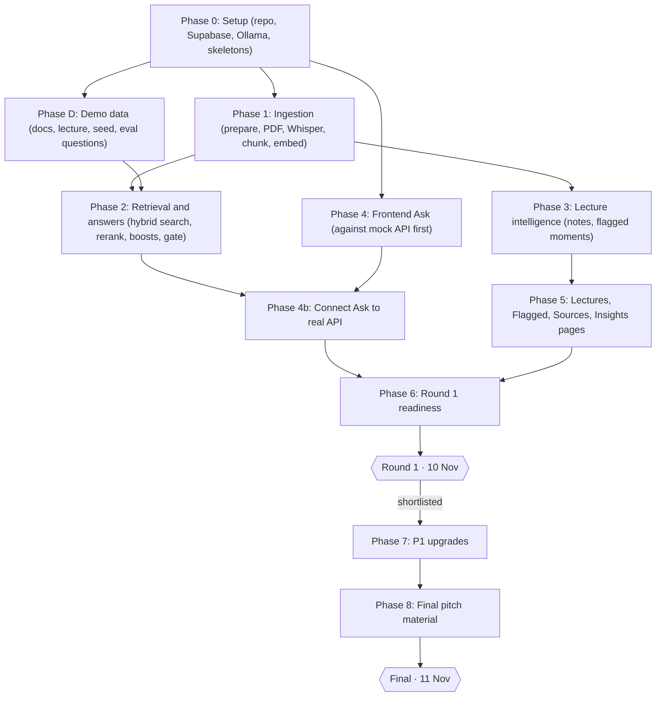
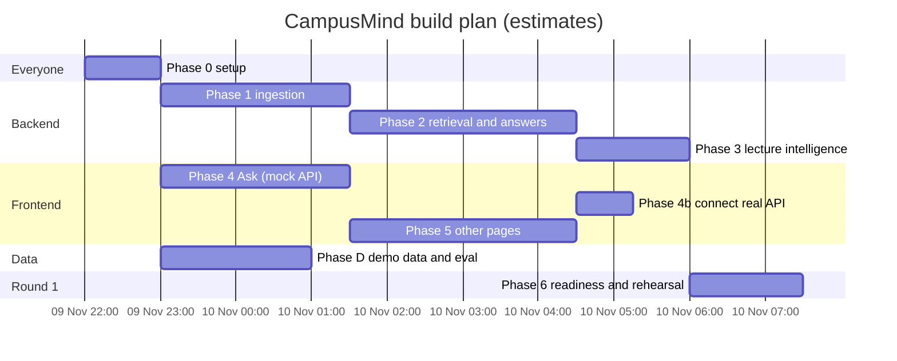
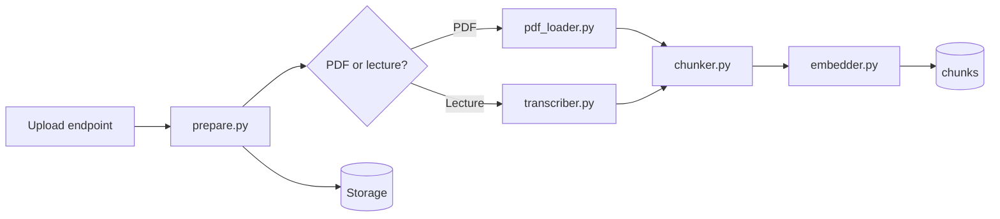
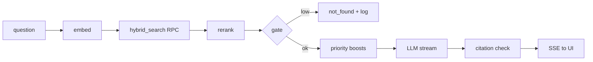
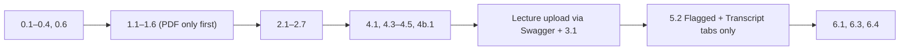

# CampusMind — Build Tasks

**Version:** v2 · **Last updated:** 2026-11-09

Work top to bottom inside your track. One task = one branch = one commit. Tick `[x]` only when the task's **Check** passes and the *Definition of done* in `Rules.md` is met. Log decisions, bugs and eval scores in `memory.md`.

**Legend:** **P0** = needed for Round 1 (10 Nov) · **P1** = before the Final (11 Nov) if Round 1 passes · ⏱ = estimate · 🔑 = on the critical path

---

## 1. Plan at a glance

### 1.1 Phases and dependencies

### 1.2 Suggested team split (2–4 people)

| Track | Owner | Phases |
| --- | --- | --- |
| **Backend / AI** | strongest Python person | 0.3–0.5, 1, 2, 3 |
| **Frontend** | web person | 0.6, 4, 5 |
| **Data and eval** | anyone | D (documents, lecture recording, seed data, eval questions) |
| **Pitch** | best speaker | 6.3–6.5, 8 |

With 2 people: Backend + Data / Frontend + Pitch.

### 1.3 Timeline (estimates — adjust to the real Round 1 time)

**If time runs out, follow the Minimum demo path (Section 12)** — it is the smallest set of tasks that still shows all three judging points.

---

## Phase 0 — Setup (everyone) · ⏱ 60 min · P0

- [ ] **0.1 🔑 GitHub repo** ⏱ 10 min
  - Create private repo `campusmind`; folders `docs/`, `backend/`, `frontend/`, `supabase/`.
  - Put all `.md` files in `docs/`; copy `docs/handoff.md` → `CLAUDE.md` at the root.
  - `.gitignore`: `.env`, `.env.local`, `backend/tmp/`, `node_modules/`, `.next/`, `__pycache__/`, `.venv/`, `*.opus`, `*.mp4`, `*.mp3`.
  - **Check:** repo cloned on every teammate's laptop.

- [x] **0.2 🔑 Supabase project and schema** ⏱ 20 min
  - Create a free Supabase project `campusmind` (region nearest Dubai).
  - Add `supabase/migrations/0001_init.sql` and `0002_hybrid_search.sql` from `Architecture.md` §4; apply them (Supabase MCP or CLI).
  - Create **private** Storage bucket `sources`.
  - Put `SUPABASE_URL` and `SUPABASE_SERVICE_ROLE_KEY` in `backend/.env` (never commit).
  - **Check:** all 9 tables exist; RLS enabled on each; `select hybrid_search('test', array_fill(0, array[1024])::vector, 5);` runs without error.

- [x] **0.3 🔑 Ollama and models** ⏱ 15 min (downloads run in background)
  - Install Ollama; pick `LLM_MODEL` from `Architecture.md` §11 for the demo laptop.
  - `ollama pull <LLM_MODEL>` and `ollama pull bge-m3`. Install ffmpeg and confirm `ffmpeg -version`.
  - Record the laptop specs and chosen model in `memory.md`.
  - **Check:** `ollama run <LLM_MODEL> "hello"` replies; `/api/embed` with `bge-m3` returns 1024 numbers.

- [x] **0.4 🔑 Backend skeleton** ⏱ 20 min
  - `backend/` venv (Python 3.11), `requirements.txt` with approved libraries only.
  - `app/main.py` (CORS for `localhost:3000`), `config.py` (all settings from `Architecture.md` §9), `db.py` (Supabase client), `.env.example`.
  - `GET /api/health` → `{ollama, supabase, llm_model, chunks}`.
  - **Check:** `/api/health` shows `ollama: true, supabase: true`.

- [x] **0.5 Seed catalog** ⏱ 10 min
  - `supabase/seed.sql`: 1–2 courses (e.g. MATH F113), 2 sections each, instructors with roles (`ic`, `hod`, `instructor`). Use real names only with permission; otherwise clearly demo names.
  - `GET /api/courses` returns courses with sections and instructors.
  - **Check:** the endpoint returns the seeded data.

- [x] **0.6 🔑 Frontend skeleton** ⏱ 30 min
  - Next.js + TypeScript (`strict`) + Tailwind in `frontend/`.
  - Tokens from `design.md` §3 in `globals.css` (light + dark); Inter via `next/font`.
  - `GlassNav` (Ask · Lectures · Flagged · Sources) and empty pages.
  - `lib/api.ts` with typed functions matching `Architecture.md` §7, returning **mock data** until the backend is ready.
  - **Check:** `localhost:3000` shows the glass nav; content scrolls under it; dark mode works.

- [x] **0.7 README** ⏱ 5 min — setup and run steps (≤ 6 commands, PowerShell variants).

---

## Phase D — Demo data and eval (data track) · ⏱ 2 h · P0

- [ ] **D.1 🔑 Collect documents** — academic regulations PDF, student handbook (or allowed sections), one MATH F113 course handout, one circular. Note permissions in `memory.md`.
- [ ] **D.2 🔑 Demo lecture** — record or obtain (with consent) a 5–8 minute lecture on one MATH F113 topic (e.g. Bayes' theorem). It must contain **two clear importance cues** ("this will definitely come in the exam", "note this formula down") and one formula said aloud.
- [ ] **D.3 🔑 Eval set** — `backend/eval/questions.json`:
  - 10 questions answered by the PDFs (with expected document + page),
  - 5 answered by the lecture (with expected timestamp range),
  - 3 out-of-scope questions (expected: refuse),
  - 2 expected flagged moments (timestamps).
- [ ] **D.4 Example questions** — 3 short, real questions for the home page chips.
- **Check:** files are in a shared folder; eval JSON validates.

---

## Phase 1 — Ingestion (backend) · ⏱ 2 h 30 min · P0

- [x] **1.1 🔑 Upload preparation** — `ingest/prepare.py` ⏱ 25 min
  - `check_size(file, MAX_UPLOAD_MB)` → 413 with a clear message.
  - `prepare_audio(in_path) -> out.opus` using `ffmpeg -i in -vn -ac 1 -ar 16000 -c:a libopus -b:a 24k out.opus` via `subprocess.run(check=True)`.
  - `prepare_pdf(in_path)`: if > `PDF_COMPRESS_OVER_MB`, `doc.save(out, garbage=4, deflate=True)`.
  - Delete temp files in a `finally` block.
  - **Check:** a 1-hour mp4 becomes ~10 MB `.opus`; a 25 MB PDF shrinks.

- [x] **1.2 🔑 PDF loader** — `ingest/pdf_loader.py` ⏱ 20 min
  - PyMuPDF → `[{text, page}]`; drop lines repeated on > 60% of pages (headers/footers); normalise whitespace.
  - **Check:** regulations PDF returns the right page numbers for 3 spot-checked rules.

- [x] **1.3 🔑 Transcriber** — `ingest/transcriber.py` ⏱ 25 min
  - faster-whisper (`WHISPER_MODEL`, `compute_type="int8"`), loaded lazily once; `vad_filter=True`.
  - Returns `[{text, start, end}]`.
  - **Check:** demo lecture transcript is readable; timestamps match the audio.

- [x] **1.4 🔑 Chunker** — `ingest/chunker.py` ⏱ 25 min
  - PDF: paragraphs within a page, 300–500 tokens, 15% overlap, never across pages.
  - Lecture: merge segments into 60–90 s windows, prefer breaks at pauses > 1.5 s; keep `start_s`, `end_s`.
  - Deterministic id `{source_id}_{page|int(start)}_{n}`.
  - **Check:** unit test — same input gives the same ids; no empty chunks.

- [x] **1.5 🔑 Embedder and store** — `rag/embedder.py`, `db.py` ⏱ 20 min
  - Batch 32 texts per `/api/embed` call; assert length `EMBED_DIM`.
  - `upsert_chunks(rows)`; `delete_chunks(source_id)` before re-indexing a source.
  - **Check:** chunk count in `/api/health` increases after an upload; re-upload doesn't duplicate.

- [x] **1.6 🔑 Pipeline + upload APIs** — `ingest/pipeline.py`, `api/documents.py`, `api/lectures.py` ⏱ 35 min
  - `POST` saves to `backend/tmp/`, inserts `sources` (status `processing`), returns `202`, runs the pipeline as a FastAPI `BackgroundTask`.
  - Pipeline: prepare → upload to Storage (`pdfs/{id}.pdf` or `lectures/{id}.opus`) → load/transcribe → chunk → embed → upsert → status `ready` (or `failed` + `error`).
  - Save the lecture transcript JSON in `lecture_notes` or Storage (`transcripts/{id}.json`).
  - `GET` list and detail endpoints; `DELETE /api/documents/{id}` removes rows + file.
  - **Check:** upload the regulations PDF and the demo lecture through `/docs` (Swagger); both reach `ready`.

---

## Phase 2 — Retrieval and answers (backend) · ⏱ 3 h · P0 — the core

- [ ] **2.1 🔑 LLM provider** — `llm/base.py`, `llm/ollama_provider.py` ⏱ 20 min
  - `generate(messages, **opts) -> str`, `stream(messages, **opts) -> AsyncIterator[str]`; temperature 0.1 for answers.
  - **Check:** a test script streams tokens from Ollama.

- [ ] **2.2 🔑 Retriever** — `rag/retriever.py` ⏱ 25 min
  - Call `rpc('hybrid_search', …)` with scope → `filter_type`, course → `filter_course`; then fetch chunk rows joined with source, section, instructor.
  - `lecture_id` scope → filter results to that source.
  - **Check:** "makeup test" query returns the right regulation chunk in the top 5.

- [ ] **2.3 🔑 Reranker** — `rag/reranker.py` ⏱ 20 min
  - `CrossEncoder(RERANKER_MODEL)` loaded at startup; score 20 pairs; return sorted with raw scores.
  - **Check:** reranked top 1 is correct for 4 of 5 sample questions.

- [ ] **2.4 🔑 Priority boosts** — `rag/priority.py` ⏱ 20 min
  - Apply `BOOST_*` from config (`Architecture.md` §3.3); return `final_score` **and** `badges[]` per passage.
  - **Check:** unit test — boosts re-order ties, badges match the boosts applied, gate still uses raw score.

- [ ] **2.5 🔑 Prompts** — `rag/prompts.py` ⏱ 20 min
  - `ANSWER_SYSTEM`: answer only from numbered passages; cite like `[2]`; if passages don't answer it, say so; ≤ 150 words; mention instructor flags when present; reply in the question's language.
  - `ANSWER_USER`: question + passages formatted `[n] (title · page/time · badges) text`.
  - **Check:** prompt renders correctly for a PDF and a lecture passage.

- [ ] **2.6 🔑 Answerer** — `rag/answerer.py` ⏱ 35 min
  - Gate: best raw score < `MIN_RELEVANCE` → insert `unanswered`, emit `not_found`, **no LLM call**.
  - Else: top 5 by `final_score` → stream LLM → collect full text → strip any `[n]` not in 1..5 → insert `answers` → emit `sources` (with excerpt + badges) and `done {answer_id}`.
  - **Check:** an invented `[9]` is removed; out-of-scope question logs to `unanswered`.

- [ ] **2.7 🔑 Ask + feedback endpoints** — `api/ask.py`, `api/feedback.py` ⏱ 25 min
  - SSE events: `token`, `sources`, `not_found`, `done`, `error`.
  - `POST /api/feedback {answer_id, rating}`.
  - **Check:** `curl -N` streams a cited answer; feedback row appears.

- [ ] **2.8 🔑 Eval runner** — `eval/run_eval.py` ⏱ 25 min
  - For each question: run the pipeline without streaming; mark correct if the expected source is cited; out-of-scope correct if refused; time to first token.
  - Print a table; write the score into `memory.md` §5.
  - **Check:** baseline recorded.

- [ ] **2.9 🔑 Tune** ⏱ 30 min
  - Adjust chunk size, `MIN_RELEVANCE`, `TOP_K_*`, prompt wording until **≥ 13/15 correct and 3/3 refused**. Log each attempt in `memory.md`.

---

## Phase 3 — Lecture intelligence (backend) · ⏱ 1 h 30 min · P0

- [ ] **3.1 🔑 Flagged moments** — `ingest/flagger.py` ⏱ 40 min
  - Cue list (config or constant): "come in the exam", "will be asked", "important", "note this down", "remember this", "asked last year", "for the quiz", "for compre", "for midsem".
  - Step 1: case-insensitive match on transcript segments → candidates.
  - Step 2: LLM (`FLAG_CHECK` prompt) with ±30 s context → `{is_flag: bool, reason: str}` as JSON.
  - Mark matching chunks `flagged = true`, `flag_reason = reason`. Run inside the pipeline before embedding.
  - **Check:** both planted cues in the demo lecture are flagged; ≤ 1 false flag.

- [ ] **3.2 🔑 Lecture notes** — `ingest/lecture_notes.py` ⏱ 30 min
  - From the transcript: 5-line summary, 4–8 key points, formulas (LaTeX-free plain text), saved to `lecture_notes`.
  - Long transcripts: summarise in parts, then combine.
  - **Check:** notes for the demo lecture are accurate when read against the transcript.

- [ ] **3.3 Flagged endpoint** — `api/flagged.py` ⏱ 15 min
  - `GET /api/flagged?course_id=` → moments with lecture title, timestamp, reason, instructor + role.
  - Include `flagged[]` and a signed `audio_url` in `GET /api/lectures/{id}`.
  - **Check:** returns the two demo flags.

---

## Phase 4 — Frontend: Ask · ⏱ 2 h 30 min (+45 min to connect) · P0

- [ ] **4.1 🔑 API client** — `lib/api.ts` ⏱ 30 min
  - Typed `ask()` that parses SSE from `fetch` (POST body) and calls `onToken`, `onSources`, `onNotFound`, `onDone`, `onError`.
  - `getCourses`, `sendFeedback`, `uploadDocument`, `uploadLecture`, `getLectures`, `getLecture`, `getFlagged`, `getInsights`.
  - Mock mode via `NEXT_PUBLIC_MOCK=1` until the backend is ready.

- [ ] **4.2 🔑 Course selector** — `CourseSelector.tsx`, `lib/prefs.ts` ⏱ 25 min
  - Glass popover: Course → Section. Remember in `localStorage` (wrapped in try/catch).

- [ ] **4.3 🔑 Ask page** — `AskBox`, `ScopeToggle`, example chips, empty state ⏱ 30 min (per `design.md` §7.1)

- [ ] **4.4 🔑 Answer view** — `AnswerView.tsx` ⏱ 30 min
  - Streaming markdown, `[n]` as accent superscripts linked to chips; loading dots; not-found and error states; `aria-live`.

- [ ] **4.5 🔑 Source chips, badges, panel** — `SourceChip`, `Badge`, `SourcePanel` ⏱ 30 min (per `design.md` §7.2–7.3)

- [ ] **4.6 🔑 Feedback buttons** — `FeedbackButtons.tsx` ⏱ 10 min

- [ ] **4b.1 🔑 Connect to the real API** ⏱ 45 min — turn off mock mode, fix contract mismatches, test every state.
  - **Check:** ask a PDF question and a lecture question in the browser; chips show correct badges; rating saves.

---

## Phase 5 — Frontend: Lectures, Flagged, Sources, Insights · ⏱ 3 h · P0

- [ ] **5.1 🔑 Lectures list + upload** — `lectures/page.tsx`, `UploadCard` ⏱ 45 min
  - Upload form (title, course, section, instructor, date), progress bar, status polling every 3 s showing *Preparing → Transcribing → Finding important moments → Ready*.
- [ ] **5.2 🔑 Lecture detail** — `lectures/[id]/page.tsx`, `Transcript`, `FlaggedList` ⏱ 60 min
  - Tabs Summary · Flagged · Transcript · Ask this lecture; `?t=` deep link scrolls and highlights; audio player seeks to the timestamp.
- [ ] **5.3 Flagged page** — `flagged/page.tsx` ⏱ 25 min — grouped by lecture for the selected course.
- [ ] **5.4 🔑 Sources: Documents tab** — `sources/page.tsx` ⏱ 30 min — table, add, delete.
- [ ] **5.5 Sources: Insights tab** ⏱ 20 min — unanswered questions (with counts) and thumbs-down answers.
- **Check:** every page passes `design.md` §2 and §11 in light and dark at 360 px and 1440 px.

---

## Phase 6 — Round 1 readiness · ⏱ 1 h 30 min · P0

- [ ] **6.1 🔑 Load demo data** into Supabase: all D.1 documents + D.2 lecture through the real upload flow. Confirm all `ready`.
- [ ] **6.2 🔑 Final eval run**; record in `memory.md`. Must meet PRD §10 targets.
- [ ] **6.3 🔑 Rehearse** the PRD §11 demo script 3 times on the demo laptop; time it; fix anything slow.
- [ ] **6.4 🔑 Backups:** screen-record the full demo; phone hotspot tested; Supabase dashboard opened (not paused).
- [ ] **6.5** Tag release `v0.1-round1`.

---

## Phase 7 — P1 upgrades (only after Round 1) · P1

- [ ] **7.1** `llm/gemini_provider.py` + `LLM_PROVIDER=gemini` switch; compare speed and eval score.
- [ ] **7.2** Practice quiz (5 MCQs per lecture, weighted toward flagged moments) in the Summary tab.
- [ ] **7.3** Voice question: mic button → record → Whisper → ask.
- [ ] **7.4** Answer in the question's language (Arabic, Hindi); add 2 eval questions per language.
- [ ] **7.5** Most-asked questions on the home page from `answers` counts.
- [ ] **7.6** Re-run eval; update `memory.md`; tag `v0.2-final`.

---

## Phase 8 — Pitch material

- [ ] **8.1** 5–6 slides: Problem · Solution · How AI helps (pipeline diagram from `Architecture.md`) · Demo · Gets smarter with use (feedback loop diagram) · Impact and future.
- [ ] **8.2** One-line answers ready for judges:
  - *Accuracy?* Answers only from sources, reranker, refuses when unsure, 13/15 on our test set.
  - *Why not ChatGPT?* It doesn't know BPDC's rules or your lectures, and it can't cite them.
  - *Privacy?* Models run locally; keys server-side; lectures only with consent.
  - *Cost?* AED 0 — open-source models and free tiers.
  - *Is instructor priority fair?* Every boost is a visible badge; nothing is hidden.
  - *Scale?* Same system works for Heriot-Watt or any university; just upload their documents.

---

## 12. Minimum demo path (if time runs short)

Do these in order and stop when time runs out; each step leaves a working demo.

What you can safely skip for Round 1: 0.5 seed UI polish, 2.8–2.9 tuning beyond the first pass, 3.2 notes, 3.3, 4.2 (hard-code one course), 5.1 upload UI (upload via Swagger), 5.3, 5.5, 6.5.
